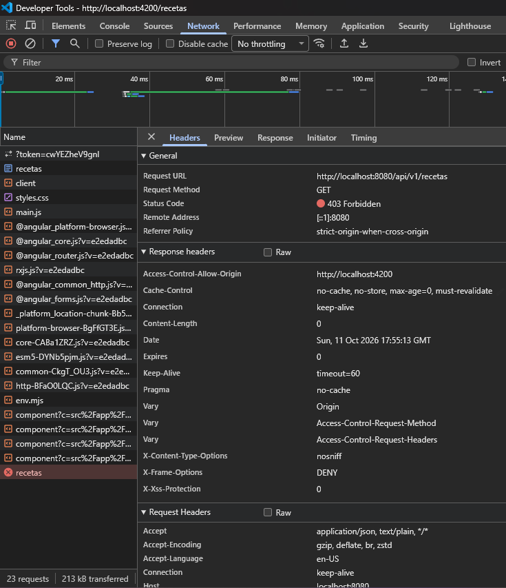

# MedPharm Express - Laboratorio 13

## Ejecución
- Backend: `cd medpharm-backend` → `./mvnw spring-boot:run` (puerto 8080)
- Frontend: `cd medpharm-frontend` → `npm install` → `ng serve` (puerto 4200)
- Usuarios de prueba: `medico1` / `password123`, `farma1` / `password123`

## Informe de depuración: error 401/403 sin interceptor

**¿Por qué el servidor rechazó la petición?**
Al quitar `withInterceptors([authInterceptor])` de `app.config.ts`, Angular envió
`GET /api/v1/recetas` sin la cabecera `Authorization`. En el backend, el filtro
`AuthTokenFilter` no encontró el token `Bearer`, por lo que no estableció ningún
usuario en el `SecurityContext`. Como `SecurityConfig` exige
`anyRequest().authenticated()` y la API es stateless (no hay sesión ni cookie),
Spring Security trató la petición como anónima y la rechazó con **403 Forbidden**
(o 401 Unauthorized según el punto de entrada configurado).

**¿Cómo lo resuelve el interceptor?**
`authInterceptor` es una `HttpInterceptorFn` que se ejecuta antes de cada petición
de `HttpClient`. Lee el JWT de `localStorage` mediante `AuthService.getToken()` y,
como las peticiones son inmutables, la clona con `req.clone({ setHeaders: { Authorization: 'Bearer <token>' } })`.
Así el backend recibe el token, `JwtUtils` valida firma y expiración, y el usuario
queda autenticado para ese request.
